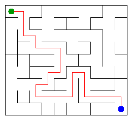

# Assignment 3 — Maze Escape

**Student ID:** `251755` (confirm that this matches your Moodle ID before submitting)  
**Name:** Azamat Mustafin
**Group:** SE-2510
**Maze size:** 9 × 10 = 90 cells  
**Required language:** Java 17+ (checked with Java 21)  

This README is the report for Assignment 3. The original assignment is at `docs/Assignment3.pdf`, and the starter's instructions are in `START_HERE.md`.

## Running and testing

Run from the directory containing `src`, `data` and `tools`:

```bash
java tools/Check.java
javac -d out src/*.java
java -cp out Main
java -cp out Bench
```

Open `output/maze.html` in a browser to view and play the maze using arrow keys. The rendered static picture is below. The generator can be rerun with `java tools/MakeVariant.java 251755 data`; **changing the ID changes the inputs and all the output numbers**. On a terminal without a graphical display, replace the `Main` command with `java -Djava.awt.headless=true -cp out Main` to produce PNG/HTML headlessly.

## Program output

The 13 required lines for the bundled, ID-derived input files:

```text
Broken: 89
Kept: 72
Last broken wall: 131
MST cost: 25886
Heaviest broken wall: 755
Path length: 25
DFS visited: 65
Dead ends: 29
Zones: 90
Largest zone: 1
Is DAG: 1
Flow stages: 15
Fastest route cost: 34
```

**My maze** (red route = DFS escape route):



## Questions and explanations

### Mission 0 — Disjoint Set Union

`find(x)` returns the representative (root) of the component containing `x`. `union(a,b)` merges two different components and returns true; if they already have the same representative, it returns false. Union by size attaches the smaller tree below the larger one, while path compression shortens future searches: together these operations take amortized `O(α(n))` time each. I used an iterative implementation, so a long chain does not cause recursion errors.

### Mission 1 — Build the maze

Initially there are `R*C` disconnected cells. Each accepted broken wall joins two different components, so to make one connected maze we need exactly `R*C-1` accepted walls. A rectangular grid contains `R*(C-1)+C*(R-1)` inner walls; subtracting the `R*C-1` broken walls leaves `(R-1)*(C-1)` kept walls. For my 9×10 maze, that is `89` broken and `72` kept.

### Mission 2 — Cheapest maze (Kruskal and Prim)

**Kruskal MST cost:** `25886`. **Prim MST cost:** `25886` (the program explicitly compares these values). Kruskal takes walls in increasing cost order and uses DSU to avoid cycles; Prim starts from one cell and repeatedly takes the cheapest edge reaching an unvisited cell. Both produce minimum spanning trees of the same connected, undirected wall graph, so their total optimal costs agree, even if the selected edges could differ when weights tie (here all costs are distinct).

### Mission 3 — Escape

Every broken wall connects previously disconnected components, so the finished maze is a connected graph with `n-1` edges: a tree. A tree has exactly one simple path between any two vertices; if there were two distinct paths, they would create a cycle. To avoid a `StackOverflowError` on a 1000×1000 maze, I used explicit arrays for DFS stack frames, checking possible exits in **up, right, down, left** order. I count a vertex the moment it is marked, including the start and exit.

### Mission 4 — Slide zones (Kosaraju)

The first DFS records vertices in their finishing order. In the second pass, I process vertices in reverse finishing order and follow the **reversed slides**: this collects the complete strongly connected component without mixing it with a different one downstream. Since the problem guarantees no self-slides, the directed slide graph is acyclic exactly when every SCC contains one cell, i.e. `Zones == n`. For these personal data, `Zones = 90` and `Is DAG = 1`.

### Mission 5 — Flow stages and fastest route

After contracting strongly connected components, the zone graph is always a directed acyclic graph (DAG). Kosaraju numbers its zones in topological order, so every inter-zone slide points from a smaller zone number to a larger one: one left-to-right dynamic-programming pass suffices. The longest chain begins with length one in each zone, and the shortest-route calculation starts with distance zero at the start zone and relaxes each directed slide; multiple slides between the same zones automatically give the cheapest time. The pass takes `O(z+s)` time and `O(z+s)` extra space for `z` zones and `s` slides.

## AI use

**ChatGPT (OpenAI)** was used to help generate initial Java implementations, extra DSU test cases, draft README explanations, and organize test and benchmark results. The solution was compiled and tested on the bundled examples and additional generated test cases. This is a record of AI assistance, not a statement that the student independently wrote every line. **Before submitting, I must review, understand and adapt the code and explanations myself**, and be ready to explain them at the individual defense. No third-party graph or DSU implementation libraries were used.

## Timing (Mission 7)

Milliseconds, **5 runs each**, measured with the starter's `Bench.java` on Java 21 in this environment. Values are the averages of five measurements, rounded to the nearest millisecond; running the benchmark on another machine will give different timings.

| Maze | Kruskal (ms) | Prim (ms) |
|---|---:|---:|
| 100 × 100 | 10 | 7 |
| 300 × 300 | 28 | 57 |
| 1000 × 1000 | 347 | 1659 |

Both algorithms take more time as the number of cells and edges grows. The time does not scale linearly with the side length, because increasing the side length from 100 to 1000 creates about 100 times as many cells and walls. In these runs Kruskal is faster for the largest grids, in part because it sorts a primitive array while Prim manages many priority-queue entries; small timings also vary because of JVM warmup and runtime effects.

## Time and space complexity

Let `n` be the number of cells, `m` the number of maze walls or directed slides, and `z` the number of strongly connected components.

| Algorithm | Time | Extra space | Notes |
|---|---|---|---|
| DSU `find`/`union` | amortized `O(α(n))` per operation | `O(n)` | union by size + path compression |
| Build in input order (Mission 1) | `O(m α(n))` | `O(n)` | scans each wall at most once |
| Kruskal MST | `O(m log m + m α(n))` | `O(n + m)` | sorts all wall costs first |
| Prim MST | `O(m log m)` | `O(n + m)` | binary heap with lazy updates; adjacency arrays |
| DFS escape | `O(n + m)` | `O(n + m)` | iterative DFS and maze adjacency; open edges are `n-1` |
| Kosaraju SCC | `O(n + m)` | `O(n + m)` | two non-recursive graph traversals |
| SCC DAG routes | `O(z + m)` | `O(z + m)` | one topological pass; no priority queue |

## Validation

- `java tools/Check.java`: **all 13 outputs correct** on each of `tiny`, `small` and `dag`.
- DSU: all starter checks and added checks pass, including a 100,000-element union chain.
- Additional independent randomized checks: 200 mazes (Kruskal/Prim cost and DFS path) and 150 directed slide graphs (SCCs and route DP) passed.
- Iterative DFS completed on a randomly generated **1000 × 1000** maze without stack overflow.
- `output/maze.png` and `output/maze.html` were successfully generated for ID `251755`.

## Before submitting

- [ ] Confirm the ID is correct and replace the name/group placeholders.
- [ ] Re-run the generator and update this README if your ID is not `251755`.
- [ ] Personally review, adapt and understand all Java code and README text; use the AI disclosure honestly.
- [ ] Commit any personal changes, and push the repository (including the earlier mission commits) to your own public GitHub repository's `main` branch.
- [ ] Check the repository includes `data/walls.txt`, `data/slides.txt`, and `output/maze.png`.
- [ ] Run `java tools/Check.java` and open `output/maze.html`.
- [ ] Submit the public GitHub link in Moodle before the deadline.
